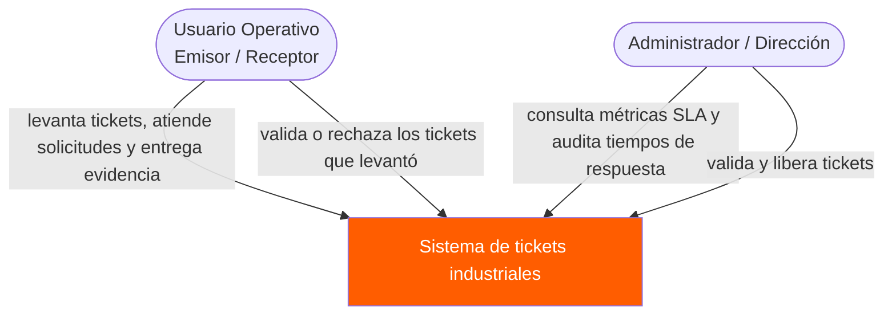
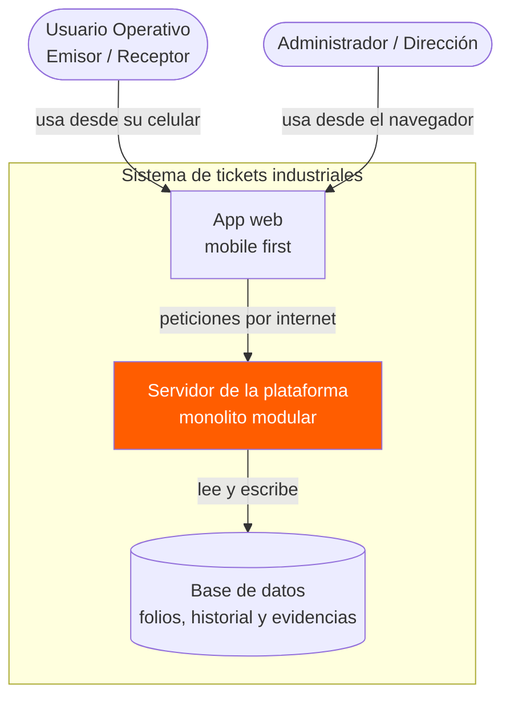
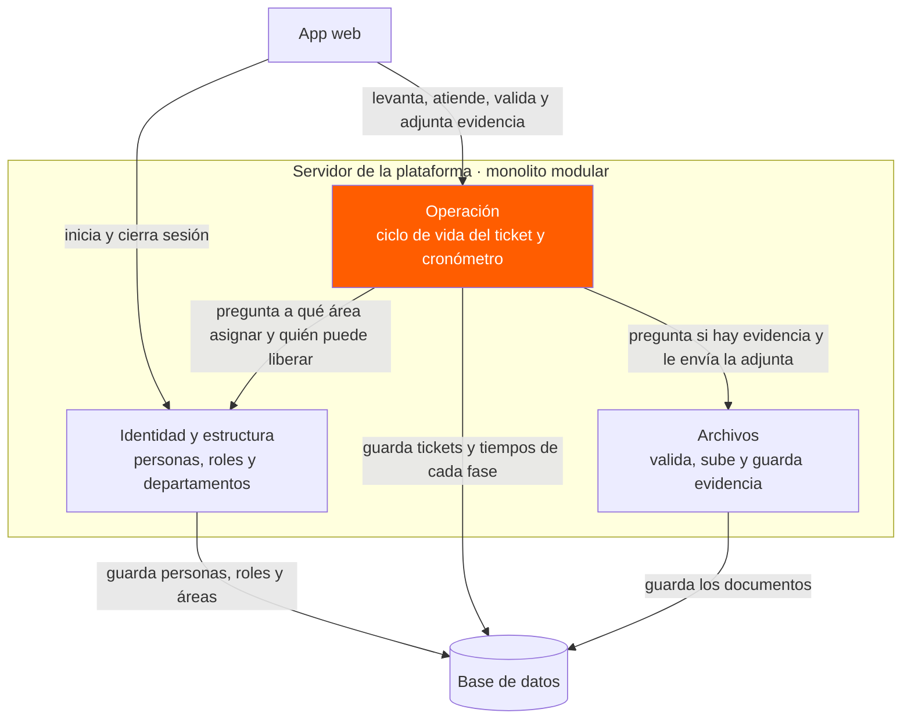
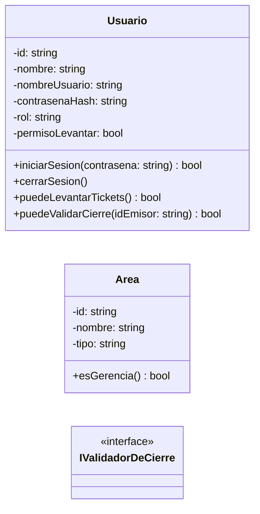
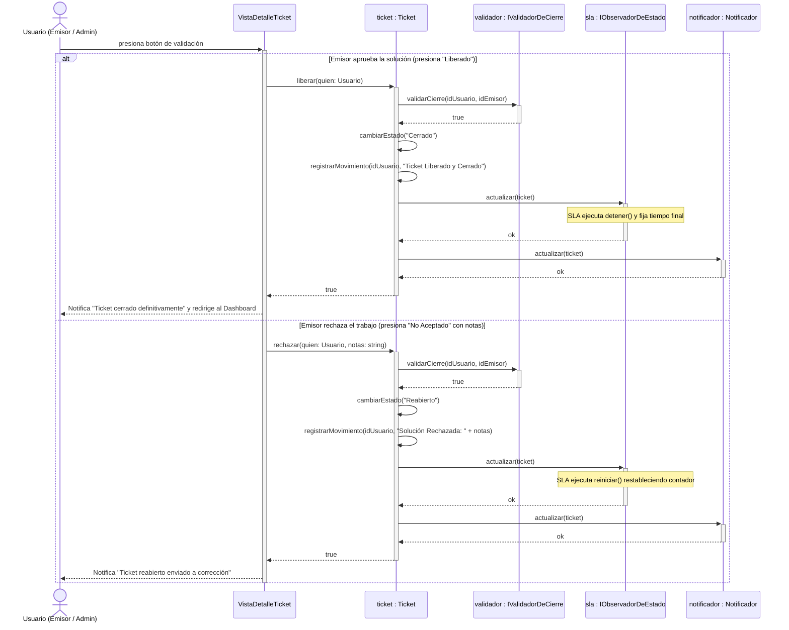
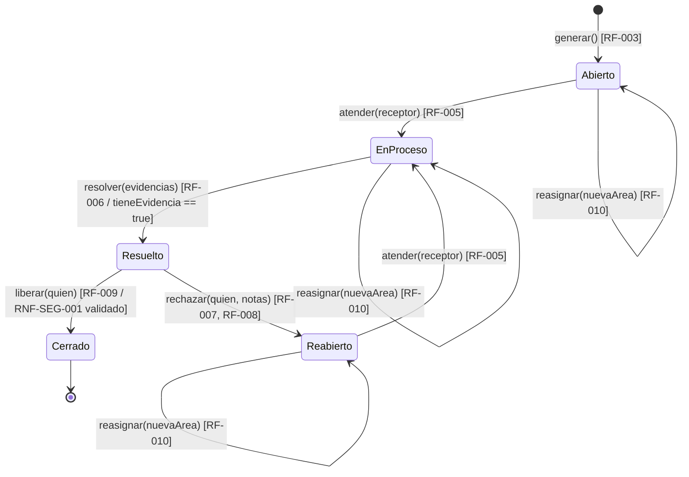

# Diagramas de Arquitectura y Diseño · Sistema de Tickets Industriales

Este documento reúne la arquitectura de software (Modelo C4) y los diagramas estructurales y de comportamiento en lenguaje UML, renderizados en bloques de texto Mermaid nativos.

---

## 1. Arquitectura C4 · Nivel 1: Diagrama de Contexto
Delimita la frontera del sistema frente a los actores operativos y directivos de la planta de producción.

---

## 2. Arquitectura C4 · Nivel 2: Diagrama de Contenedores
Muestra la estructura interna a alto nivel, separando la interfaz de usuario, el servidor y la base de datos.

---

## 3. Arquitectura C4 · Nivel 3: Diagrama de Componentes
Desglosa el monolito modular del servidor en sus componentes principales.

---

## 4. Diseño Estructural · Diagrama de Clases UML
Representa las entidades principales del dominio y sus métodos de validación y operación.

---

## 5. Diseño de Comportamiento · Diagrama de Secuencia UML
Modela el flujo de interacción paso a paso durante la validación y cierre (o rechazo) de un ticket.

---

## 6. Diseño de Comportamiento · Diagrama de Estados UML
Define el ciclo de vida completo de un ticket de trabajo y los eventos que provocan sus transiciones.

